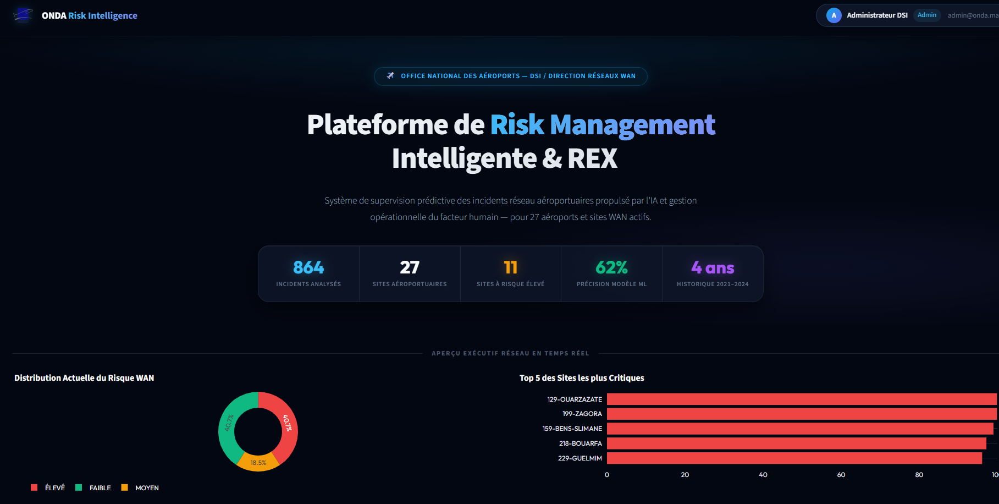
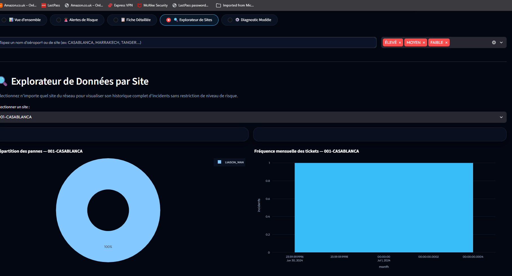
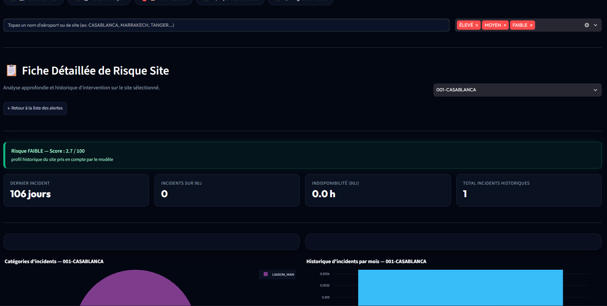
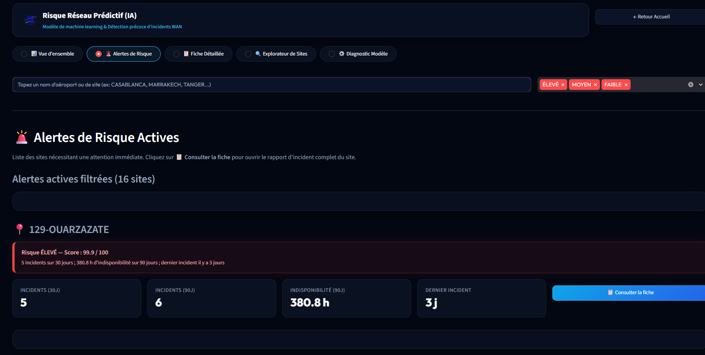
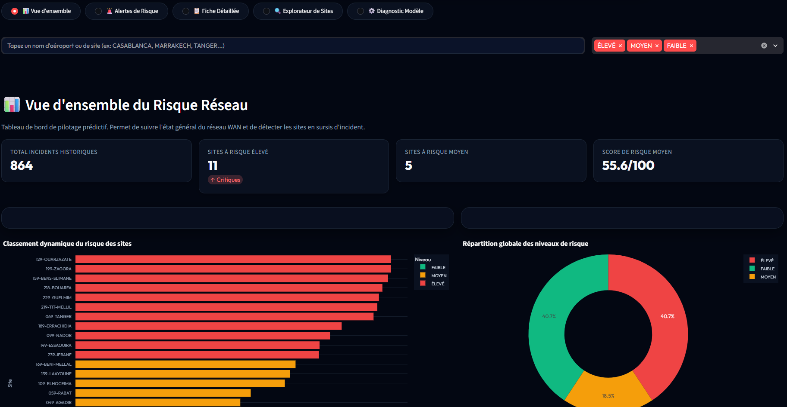
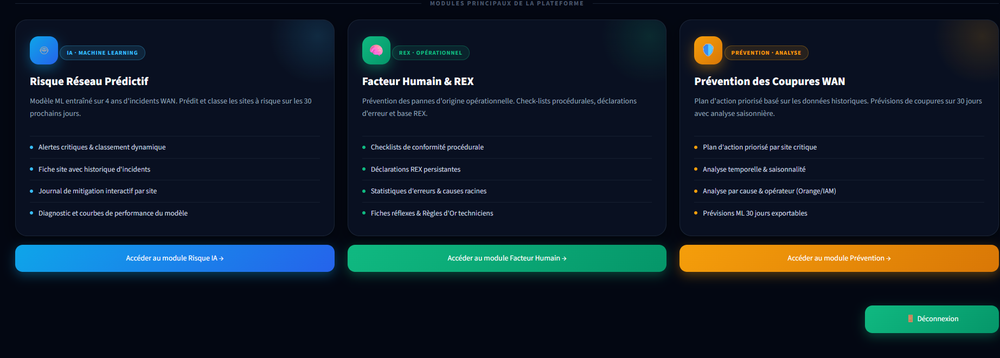
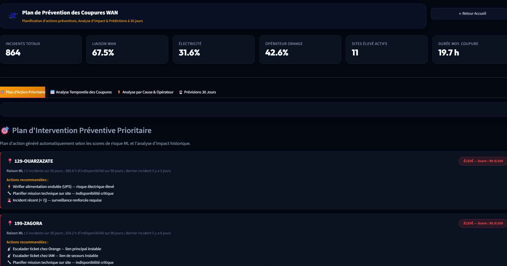
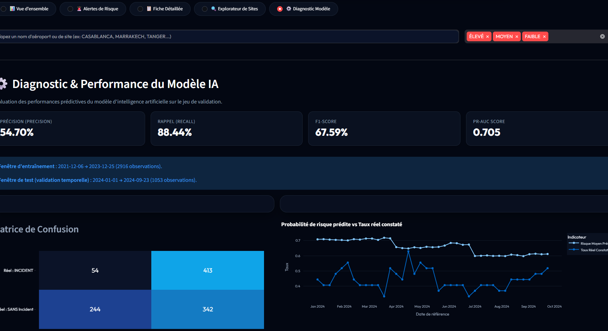
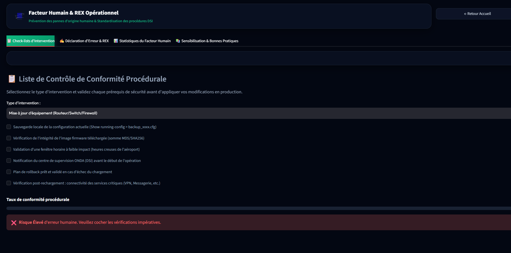

# ONDA — Analyse des risques et alertes prédictives des actifs informatiques

**Projet de fin d'année - 4ème Année en Ingénierie Informatique et Réseaux**

**Conception d'un modèle d'analyse des risques et d'alertes prédictives basé sur les données de maintenance des actifs informatiques**

---

## Auteurs et Encadrement

**Réalisé par :**
- Azzat Nouamane
- Hnid Aimane

**Encadrement professionnel :** Mme Jaouhari Ouafaa — ONDA  
**Encadrement pédagogique :** Mme Khadija Bousmar — EMSI

**Organisme d'accueil :** Office National des Aéroports (ONDA)  
**Année universitaire :** 2025–2026

---

## Captures de l'interface ONDA

<div align="center">
  
  <p><em>Accueil de la plateforme ONDA</em></p>

  
  <p><em>Écran de connexion</em></p>

  
  <p><em>Explorateur des actifs et incidents</em></p>

  
  <p><em>Fiche détaillée d'un site ou d'un actif</em></p>

  
  <p><em>Vue des alertes et niveaux de risque</em></p>

  
  <p><em>Vue d'ensemble des risques et tendances</em></p>

  
  <p><em>Modules fonctionnels de la solution</em></p>

  
  <p><em>Module de prévention des coupures WAN</em></p>

  
  <p><em>Analyse du modèle et des performances</em></p>

  
  <p><em>Module facteur humain et retours d'expérience</em></p>

  
  <p><em>Logo ONDA</em></p>
</div>

---

## Résumé du Projet

Ce projet porte sur la conception d'un modèle d'analyse des risques et d'alertes prédictives basé sur les données de maintenance des actifs informatiques de l'Office National des Aéroports. L'objectif est de transformer les données de maintenance en alertes compréhensibles et exploitables pour l'aide à la décision.

### Objectifs Principaux

- Transformer les données de maintenance en alertes prédictives compréhensibles
- Permettre une vision structurée des incidents et des tendances
- Intégrer un CyberRange isolé pour la validation de scénarios de sécurité
- Fournir une aide à la décision pour les équipes réseau et maintenance

### Architecture de la Solution

La plateforme associe quatre modules fonctionnels :
1. **Portail exécutif** — Vue globale de l'état du réseau et distribution des niveaux de risque
2. **Module de risque réseau** — Piloté par un modèle de machine learning pour prédire les incidents
3. **Module facteur humain et REX** — Gestion des checklists, erreurs et retours d'expérience
4. **Module de prévention des coupures WAN** — Analyse des causes, opérateurs et prévisions

Un **CyberRange isolé** complète la validation en reproduisant des scénarios d'incidents autorisés, depuis l'observation jusqu'à la détection et la remédiation.

---

## Ce que le prototype fait

1. Lit automatiquement les feuilles 2021, 2022, 2023 et 2024 du fichier Excel.
2. Nettoie et normalise les sites, les opérateurs et les catégories d'incidents.
3. Construit un dataset **site-semaine**.
4. Crée des variables uniquement à partir du passé :
    - incidents sur 7, 30, 90 et 180 jours ;
    - durée d'indisponibilité ;
    - jours depuis le dernier incident ;
    - incidents IAM, Orange et électriques ;
    - historique du site.
5. Entraîne une régression logistique pour prédire :
    **au moins un incident pendant les 30 jours suivants**.
6. Produit un score de risque de 0 à 100 et trois niveaux :
    - faible ;
    - moyen ;
    - élevé.
7. Affiche les résultats dans une interface Streamlit.

## Architecture

```text
onda_risk_poc/
├── app.py
├── requirements.txt
├── train_windows.bat
├── run_windows.bat
├── data/
│   └── ONDA-Projet-WAN-Liste-incident-202109-202410.xlsx
├── src/
│   ├── data_pipeline.py
│   └── train_model.py
└── artifacts/
    ├── incidents_clean.csv
    ├── site_week_dataset.csv
    ├── test_predictions.csv
    ├── latest_risk_scores.csv
    ├── feature_importance.csv
    ├── metrics.json
    └── risk_model.joblib
```

## Installation sur Windows

VirtualBox n'est pas nécessaire.

1. Installer Python 3.12 ou 3.13.
2. Ouvrir le dossier dans VS Code.
3. Ouvrir un terminal PowerShell dans le dossier.
4. Exécuter :

```powershell
python -m venv .venv
.venv\Scripts\activate
python -m pip install --upgrade pip
pip install -r requirements.txt
```

## Réentraîner le modèle

Double-cliquer sur `train_windows.bat`, ou exécuter :

```powershell
.venv\Scripts\activate
python src\train_model.py
```

## Lancer l'interface

Double-cliquer sur `run_windows.bat`, ou exécuter :

```powershell
.venv\Scripts\activate
streamlit run app.py
```

L'application s'ouvrira normalement dans le navigateur sur :

```text
http://localhost:8501
```

## Limite méthodologique importante

Les données fournies décrivent surtout les incidents WAN par site. Le prototype prédit donc le risque
par **site**, et non par équipement individuel. Pour prédire une panne de routeur précis, il faudrait
ajouter un identifiant d'équipement, son modèle, son âge, ses maintenances et ses caractéristiques.

---

## Méthodologie de Développement

Le développement suit une démarche itérative inspirée de Scrum. Le binôme découpe le projet en incréments :

1. **S1** — Cadrage ONDA, collecte des attentes et inventaire des données
2. **S2** — Nettoyage, exploration et définition des indicateurs
3. **S3** — Entraînement et évaluation du modèle
4. **S4** — Portail exécutif et module d'alertes
5. **S5** — Facteur humain, checklist et REX
6. **S6** — Prévention WAN, opérateurs et prévisions
7. **S7** — CyberRange isolé et collecte des preuves
8. **S8** — Intégration, tests et rédaction

À chaque itération, un résultat démontrable est produit pour vérifier que les composants contribuent bien au même objectif de prévention.

---

## CyberRange — Laboratoire de Validation Sécurité

### Principes de Sécurité

- Utiliser uniquement des machines vulnérables prévues pour l'entraînement (Metasploitable 2)
- Maintenir le mode Host-Only et vérifier l'absence de route vers Internet
- Ne pas réutiliser les charges, identifiants ou indicateurs sur une infrastructure réelle
- Conserver les captures comme preuves de laboratoire avec leur contexte
- Associer chaque observation à une mesure défensive : détection, durcissement, segmentation ou remédiation

### Scénario de Validation

Le CyberRange permet de :
- Observer les preuves réseau et système
- Consigner les indicateurs et règles de détection
- Proposer des mesures de remédiation
- Transformer les enseignements techniques en retour d'expérience

---

## Besoins Fonctionnels Couverts

- **BF1** — Afficher une vue exécutive de l'état du réseau et de la distribution des niveaux de risque
- **BF2** — Calculer et classer un score de risque compris entre 0 et 100 pour chaque site
- **BF3** — Filtrer les alertes par niveau, rechercher un site et ouvrir sa fiche détaillée
- **BF4** — Consulter l'historique, les catégories d'incidents, la durée d'indisponibilité
- **BF5** — Diagnostiquer le modèle à l'aide de métriques et d'une matrice de confusion
- **BF6** — Analyser les causes, les opérateurs et les saisonnalités pour générer des recommandations
- **BF7** — Contrôler une intervention par checklist et enregistrer un REX
- **BF8** — Reproduire un scénario de sécurité en laboratoire isolé et relier la remédiation au REX

---

## Mots-clés

Analyse de risques, maintenance informatique, réseau WAN, apprentissage automatique, alertes prédictives, CyberRange, détection, REX.

---

## Conclusion

Le contexte ONDA justifie une approche qui dépasse le simple affichage de tickets. La solution retenue transforme l'historique de maintenance en priorités prédictives et ajoute un laboratoire de validation pour renforcer la compréhension des incidents et la préparation à la réponse.
